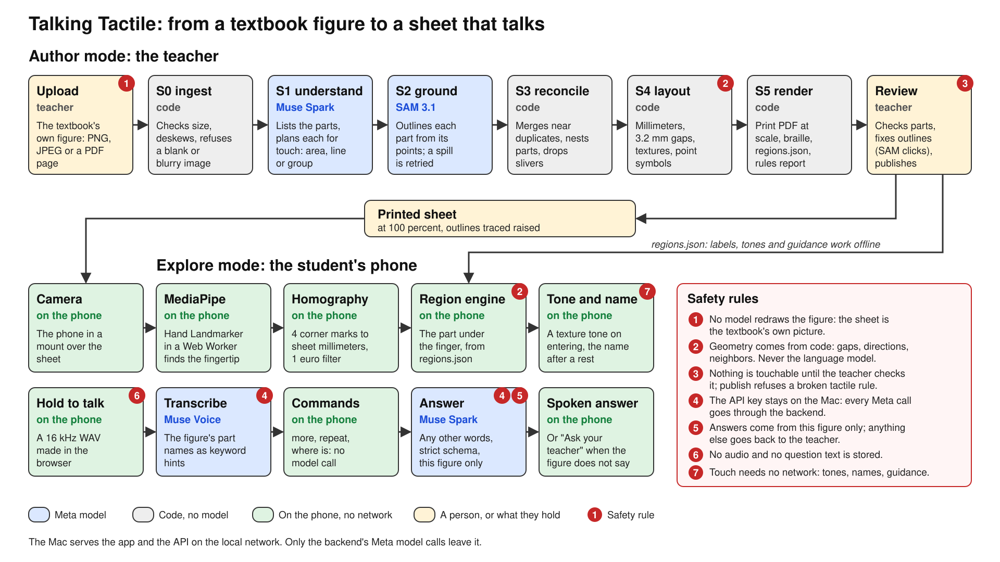
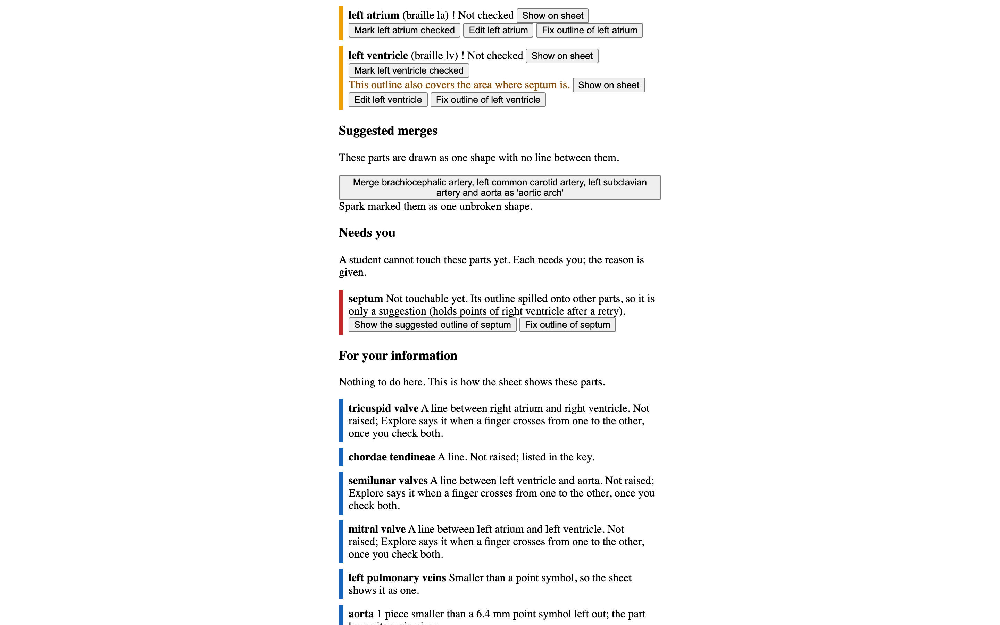
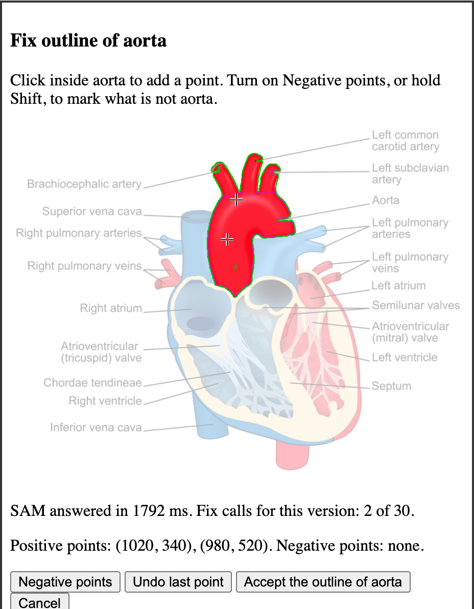
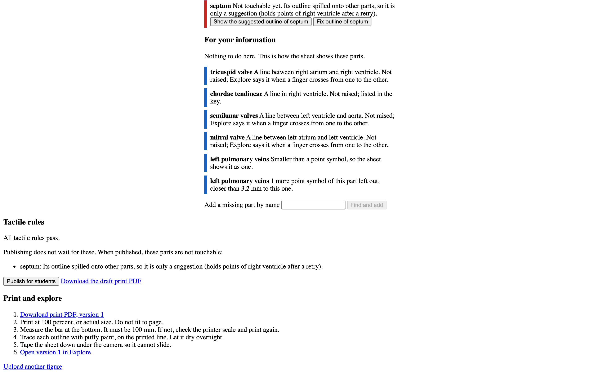
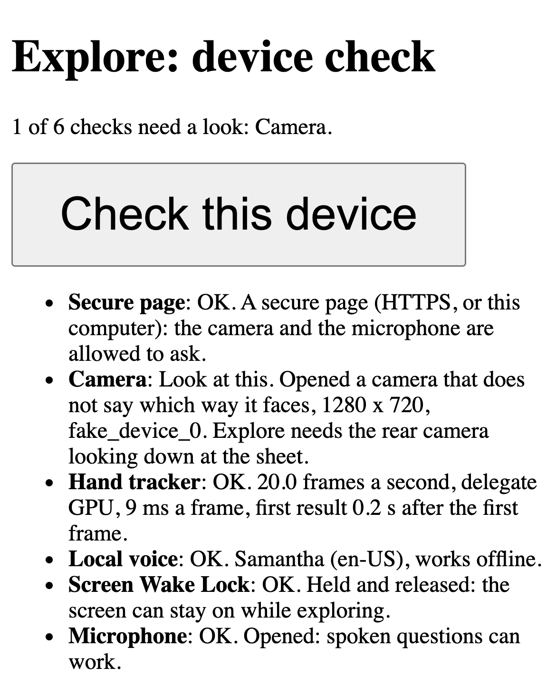

# Talking Tactile

Talking Tactile turns a printed STEM figure into a raised graphic that a blind student explores
by touch. A teacher uploads the figure; Meta's models find its parts; the teacher checks them
and prints the sheet. A phone camera over the sheet finds the student's fingertip and speaks
the part under it, and the student can ask questions out loud, answered from that figure only.

Built for the Meta Global AI Developer Hackathon (Indie track). Uses `muse-spark-1.3`,
`sam-3.1` and `muse-voice-transcribe-1.0` through the Meta Model API.

## Quickstart for a judge (mock mode, no key, no network calls)

Mock mode replays live Meta answers recorded in `fixtures/recorded/` for two figures: the heart
(`fixtures/heart.png`) and the Commons brain (`fixtures/eval/brain_lobes.png`). It costs
nothing and needs no API key.

Needs: macOS or Linux, [uv](https://docs.astral.sh/uv/) (it fetches Python 3.11), Node 24 and
liblouis for braille (`brew install liblouis`, or `apt install liblouis-bin liblouis-data`).

```
git clone https://github.com/DeepakKTS/talking-tactile.git
cd talking-tactile
make install
MOCK_META=1 make dev        # API on :8000, web on http://localhost:5173; Ctrl-C stops both
```

`make install` ends with npm reporting 11 moderate advisories, all in the lint tools that never
reach the browser (`docs/SECURITY.md`), and a note that `fsevents` has install scripts. Neither
stops anything.

Author (the teacher):

1. Open http://localhost:5173/author and upload `fixtures/heart.png`.
2. Wait for "Ready for review." (about 25 s in mock mode). The parts Spark listed and SAM outlined appear, with what
   needs the teacher (the septum, which spilled onto its neighbor) and a merge proposal (the
   aortic arch, drawn as one shape).
3. Press "Mark all parts checked" and confirm, then "Publish for students". A sheet with no
   checked part, or one that breaks a tactile rule, is refused.
4. Download the print PDF, or press "Open version 1 in Explore".

Explore (the student): touching needs the printed sheet under a camera (a phone in a mount,
`docs/DEMO.md`). Without one, Explore still starts from the keyboard: Enter presses Start, H
says the help. In mock mode a typed question is answered from the question eval's live
recordings (answer prompt v2, `fixtures/recorded/qa7_*`): an eval question asked with no part
under the finger is answered wherever the finger is, and any other question says "Questions
are not working right now. Labels still work."

Live mode: copy `.env.example` to `services/api/.env`, set `MODEL_API_KEY`, and run the API
with `LIVE=1` (`docs/DEMO.md` has the commands, terminal by terminal).

For a demo with the iPhone: `make preflight` checks the setup (OK or FAIL per check), and
`make demo-live` or `make demo-mock` starts the API, the phone's web server and the Gate B page
together and prints the iPhone URLs (`docs/DEMO.md`). The submission write-up and video script
are in `docs/submission/`; the security pass is in `docs/SECURITY.md`.

Checks: `make check` runs every test suite, lint and type check, as the pre-commit hook and CI
(`.github/workflows/tests.yml`) do.

## Screens



From a headless mock-mode run (`docs/submission/screenshots/`):

| | |
|---|---|
|  |  |
| The review: what needs the teacher, and why | Fix outline: two clicks, SAM answers |
|  |  |
| Published: print it, then open it in Explore | The device check (headless Chrome, so the camera says nothing about which way it faces) |

The heart: "Heart diagram-en.svg by ZooFari, CC BY-SA 3.0, via Wikimedia Commons. Resized and
placed on a white background." (`ATTRIBUTION.md`)

## How it works

### Author: S0 to S5

Each stage is a file in `services/api/app/pipeline/`, cached per stage so an edit reruns only
what it changes. The job's identity includes the pipeline version.

| Stage | What it does | Model |
|---|---|---|
| S0 ingest | Checks type and size (10 MB, 50 million pixels), renders a PDF page, deskews a photographed page, refuses a blank or blurry image, brings the longest side to 2048 px, hashes the pixels as the figure id | none |
| S1 understand | Lists the parts as short phrases with the subject, title, summary and a verdict (make tactile, two sheets, or describe in words only). A second call plans for touch: each part an area, a line or a group, with points on the figure | Muse Spark |
| S2 ground | One point-prompt call per located part, four at a time. Code guards the points (off text and leader lines), retries a mask that spills onto a neighbor's points, refuses an oversize mask, and gives contested pixels to the smaller mask. Print text is found in code | SAM 3.1 |
| S3 reconcile | Code merges near duplicates, nests a part inside its parent, gives partial overlaps to the smaller part and drops slivers. (A Spark pass over numbered outlines is planned in PLAN.md and not built) | none |
| S4 layout | Contours to polygons in page millimeters, the 3.2 mm gap kept by shrinking (never moving), up to 5 textures, parts too small to enter as point symbols, lines listed in the key, the subject's outline raised | none |
| S5 render | `tactile.svg`, `print.pdf` at exact scale with a 100 mm bar, `regions.json` (the contract, `docs/regions.schema.json`), UEB braille through liblouis, and the tactile rules report | none |

Directions, neighbors, distances and every geometric decision come from code; the model never
guesses geometry.

### Safety rules on the sheet

- **The teacher confirms.** A part is touchable only after the teacher checks, renames,
  describes, merges into, adds or outlines it (`app/pipeline/edits.py`). Publishing is refused while no part is checked, and while the rules report
  lists a violation.
- **A spill is never touchable.** A mask that holds another part's points, even after a
  retry, goes to "Needs you" as a suggestion only.
- **Lines are not areas.** A valve or a sulcus is a line between two areas: listed in the key,
  never raised as an area, and spoken when the finger crosses it.
- **Point symbols.** A part whose longest side is under 6.4 mm, or whose enterable area is
  under a 6.4 mm point symbol's (about 23 mm²), becomes a point symbol
  (`config/tactile_rules.yaml`, with sources).

### Explore: the touch path

- MediaPipe Hand Landmarker runs in a Web Worker (`apps/web/src/workers/`), on the newest
  camera frame only; the model file is served by the app, so touch works with no internet.
- A homography from the four printed corner marks maps the fingertip to sheet millimeters;
  the contact point sits 4 mm back from the tip, through a 1 euro filter.
- The region engine enters a part when the point is 1 mm inside it for 120 ms and leaves it
  2 mm outside, so edges do not flicker. Entering plays the part's texture earcon (at most 6
  earcons a second); resting 600 ms says its name. M says more (the teacher's description),
  W says what is here, "where is the aorta" guides with beeps.
- Labels and earcons come from `regions.json` alone: Explore works offline, with the last
  good copy of each sheet kept on the device.

### Explore: the question path

- Hold the screen to talk. Capture runs on 250 ms after letting go, up to 15 s; the WAV is
  16 kHz mono, made in the browser.
- The backend sends it to Muse Voice Transcribe with the figure's part, line and group names
  as keywords (`POST /api/transcribe`) and returns the words. Explore reads them first: "more",
  "repeat", "stop", "what is here" and "where is ..." are handled on the phone, with no model
  call. Anything else goes to `POST /api/ask` with the touch context, and the backend sends it
  with the published figure (its image and its parts in words) to Muse Spark.
- Spark answers under a strict JSON schema built per figure: a source (figure, teacher
  description, off figure, unsure) and the parts it cites, from the figure's ids only. An
  answer from a teacher description must name a part that has one.
- Code has the last word: off-figure and unsure answers get fixed sentences that send the
  student to the teacher, an answer keeps at most two sentences, and cited ids must exist.
- A session has 50 questions. A question with no answer at 8 s says "Still working on that."
  once; at 20 s the browser gives up with "That took too long. Please ask again."; the server
  stops its Meta calls at 25 s.
- The API key stays on the backend. Camera frames never leave the browser.

## Results

Every number here is from a committed result file; rerun the command to reproduce it.

| What | Result | File |
|---|---|---|
| Questions, live, answer prompt v2 at minimal reasoning effort (Nov 3) | Heart: source right 36 of 38, citations right 35. Commons brain: 35 of 35, 34. The "unsure" fallback fired 0 times. 3 heart and 5 brain answers use a word not in the figure data, a lead for a reader, not a verdict | `eval/qa/RESULTS.md` |
| Questions about the picture (shape, biggest, top and bottom), in the same run | Heart: source right 5 of 6, citations 4. Brain: 6 of 6, 5. Without the image (Oct 30, prompt v1): 3 of 6 each | `eval/qa/RESULTS.md`, `RESULTS_image_no_image.md` |
| Release to first spoken word (headless Chrome on a Mac, live, prompt v2, minimal effort) | p50 5.0 s over 12 held questions (8.5 s at "low"); 10 of 12 within 6.0 s, two at 13.8 and 14.7 s | `eval/qa/VOICE.md` |
| Transcribe on synthetic speech | Every word right on 3 clips, with and without keywords | `eval/qa/VOICE.md` |
| Part plan, touchable areas | Heart 14 of 15, Japan regions 9 of 9, flower 7 of 13 | `eval/plan/RESULTS.md` |
| S2 against the graded reference masks | Heart 0 regressions of 4, flower 3 of 3 | `eval/plan/RESULTS.md` |
| Spend so far | `python3 scripts/tracker.py spend` | `TRACKER.html` |

## Known limitations

<!-- tt:limits-touch -->
- **Touch accuracy on the phone is not measured yet.** Gate B (mean fingertip error 4 mm or
  less, `eval/gate-b/README.md`) has not run on the demo iPhone, and the device latency film
  has not been made. `make results` fills this in from the measurements.
<!-- /tt:limits-touch -->
- **A sighted helper sets the corners.** There is no automatic registration and no check that
  the phone or the sheet moved after it (`docs/EDGE_CASES.md` X5, X6).
- **Questions need the network and the Meta API**, and can be slow: 5.0 s at p50 from letting
  go to the first word on a Mac, with some answers near 15 s, most of it Spark
  (`eval/qa/VOICE.md`). Offline, mock mode answers
  only the eval's recorded questions.
- **Answers can stray in wording.** The scorer flags 3 heart and 5 brain answers for words not
  in the figure data (`eval/qa/RESULTS.md`).
- **Voice is tested on synthetic speech only**, and English only.
- **Small parts are hard for S2.** On the flower, 6 of 13 areas need the teacher and all 3
  reference parts regressed (`eval/plan/RESULTS.md`).
- **Some figures cannot publish as made.** The flower has 2 tactile rule violations and a
  private test figure (not distributed) 1; the teacher must edit them first.
- **No undo** for a merge, delete or check (`docs/EDGE_CASES.md` E4).
- iPhone HEIC photos are refused: upload PNG, JPEG or PDF.
- The question cap lives in server memory and starts over when Explore reloads.
- CI on Linux skips three replay tests (their recorded requests hold PNGs encoded on macOS),
  and the headless browser tests run locally, not in CI.

## License

The code is under the Apache License 2.0 (`LICENSE`). The figures, the sheets and data made
from them, and the recorded model answers keep their own licenses (`NOTICE`,
`ATTRIBUTION.md`): the heart's and the Japan map's are share-alike.

## Documents

| File | What it is for |
|---|---|
| CLAUDE.md | The project map |
| PLAN.md | The full plan: architecture, pipeline, edge cases, eval, risks |
| RULES.md | Hard rules: privacy, grounding, tactile design, budgets, accessibility, style |
| docs/EDGE_CASES.md | Edge cases: what the code does, what it should, and the fixes |
| docs/DEMO.md | Filming runbook |
| eval/gate-b/README.md | The touch accuracy protocol |
| ATTRIBUTION.md | Every third-party figure, model file and library, with its license |
| TRACKER.html, TODO.md | Project memory, through `scripts/tracker.py` |

## Privacy

This build sends a student's spoken question to Meta's API: when a student holds the screen
and asks, Explore records the question in the browser and the backend sends that recording to
Muse Voice Transcribe, then sends the transcript, with the published figure and its image, to
Muse Spark. A typed question goes to Muse Spark the same way.

What Meta's docs say (read on Oct 30, 2026 at dev.meta.ai; RULES.md 1.4):

- The mode is chosen by the model in each request, not by a request field: on pay-as-you-go
  you "switch between the two by choosing the model ID" (docs/models), and the Terms of
  Service say "the designation of the Services as Contributor Services or Standard Services is
  determined by the designation of the Model you are using" (section 1).
- Standard: "In Standard mode, you pay standard prices and your content is not used to train
  Meta models" (docs/pricing-rate-limits). Under the Terms, Meta "will not use Content
  submitted in a request to the Standard Services to train Meta Models" (section 5.1).
- Contributor: "discounted pricing or more usage in exchange for permission to use your
  content", meaning "the prompts, code, files, and context you send, plus the model responses
  you get back", "to train future Meta models" (docs/pricing-rate-limits). The Terms add "You
  must not submit sensitive, confidential, or personal information to the Contributor
  Services" and "the Contributor Services do not offer a mechanism to exclude specific traffic
  from training" (section 6.2).
- Which models: Muse Spark has both (`muse-spark-1.3` Standard, `muse-spark-1.3-contributor`
  Contributor). "Contributor mode isn't available for Muse Voice Transcribe." SAM 3.1 and Muse
  Voice Transcribe are listed as Standard Models (legal/geographic-use-policy).
- Coding harness subscriptions (Muse Code) are Contributor by default "regardless of which
  Meta Model you select"; Standard there needs "the applicable setting in your Account"
  (Terms, section 3.3).
- Credits, from the Model API dashboard rather than the docs: on 2026-10-27 the billing page at
  dev.meta.ai showed, verbatim, "While using free credits your content may be used for product
  improvement", with a "Stop using free credits" link (screenshot taken by Deepak, the project
  owner). The docs pages read on Oct 30 do not mention this, and do not explain how it
  interacts with Standard models, whose content "is not used to train Meta models". The Terms
  mention promotional credits (section 13.3) and leave use "through promotional credits" out of
  Meta's indemnity for the Standard Services (section 17.2), and say no more about them.
- Retention: the pricing page mentions zero data retention ("priced at parity with Standard
  mode" for Muse Voice Transcribe); the pages read do not say how to get it.

What this build does: every call uses a Standard model (`muse-spark-1.3`, `sam-3.1`,
`muse-voice-transcribe-1.0`), and the backend refuses to start with a Contributor model id
(`app/config.py`, MetaModels).

What the teacher or school must do before a class uses it:

- Run it with an API key on the Model API, not through a Muse Code or other coding harness
  subscription, or set that account to Standard (Terms, section 3.3).
- Keep the models in `config/tactile_rules.yaml` as they are.
- Stop using free credits before a class uses it (the "Stop using free credits" link on the
  billing page), or confirm with Meta that content sent on free credits to Standard models is
  not used for product improvement. Until one of these is done, assume a student's question may
  be used, as the billing page says.
- Read Meta's terms for retention and promotional credits themselves, or ask Meta: the pages
  above do not settle how long request content is kept, or how to get zero data retention.

What stays where:

- The recording is made in the browser only while the screen is held, and a quarter second
  after. The backend passes it to
  the transcribe endpoint and keeps no copy; the transcript comes back to Explore with the
  answer and is shown on the student's screen only.
- The cost ledger (`eval/live/ledger.jsonl`) logs every Meta call with its time and price. For a
  question it logs the figure and the question's length, never its words. (Lines from the
  question eval of Oct 30, logged before this rule, hold the eval's own synthetic questions.)
- Recordings of calls are written only when a developer sets `META_RECORD`; the ones in
  `fixtures/recorded/` are synthetic questions and synthetic speech.
- Camera frames stay in the browser (RULES.md 1.2), and the API key stays on the backend.
